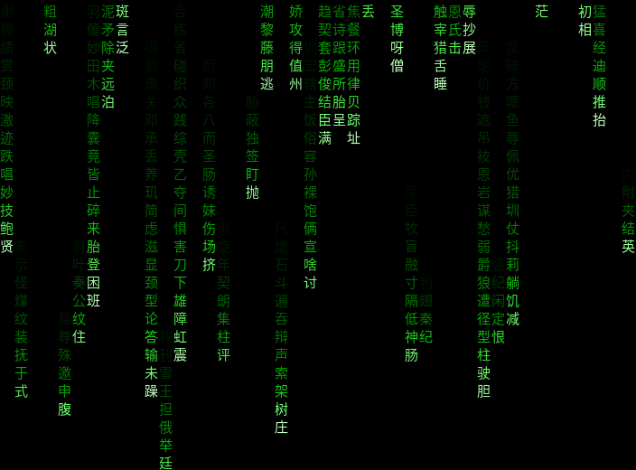

# matrix

[](https://github.com/soda92/matrix/actions/workflows/ci.yml)
[](https://github.com/soda92/matrix/releases)
[](go.mod)
[](LICENSE)

A falling-glyph rain for your terminal, written in Go. Think `cmatrix`, but
with smooth color gradients, live hue animation, automatic resize, and
Chinese/Japanese/Korean glyph sets that respect double-width cells.



```sh
matrix -L cn -c rainbow
```

## Why another one

`cmatrix` is great, but it paints a fixed green and usually needs a restart
when the window changes size. `matrix` fixes both:

- **Dynamic color.** Each trail fades from a dark tail to a bright, whitened
  head. The hue can rotate over time (`--hue-speed`, `-c rainbow`, or `r`), and
  ten palettes are one keypress away.
- **Auto-resize.** The terminal size is checked a few times per second; the
  grid is rebuilt in place and the existing rain keeps falling. Resizing while
  paused works too.
- **Languages.** Katakana, Latin, Japanese, Simplified Chinese, Traditional
  Chinese, and Korean. Wide CJK glyphs are laid out on two-column cells so the
  columns stay aligned.
- **One static binary.** No ncurses; pure Go with `golang.org/x/term`
  compiled in.
- **Scriptable captures.** `--seed`, `--frames`, and `--size` render
  deterministic frames without a terminal, which is how the demo above is
  generated.

## Install

Download a binary from [Releases](https://github.com/soda92/matrix/releases),
or:

```sh
go install github.com/soda92/matrix@latest
```

Or from a clone:

```sh
make install            # or: go install .
make build              # ./matrix
```

## Usage

```sh
matrix                       # classic green katakana
matrix -L cn                 # simplified Chinese
matrix -L tw -c red          # traditional Chinese, red
matrix -L jp --hue-speed .15 # Japanese, drifting hue
matrix -C '01'               # custom glyph set, binary rain
matrix -c rainbow -b         # rainbow, bold
```

### Languages

| Name | Glyphs | Cell width |
| --- | --- | --- |
| `classic` (default) | halfwidth katakana + digits + ASCII | 1 |
| `latin` | ASCII letters, digits, symbols | 1 |
| `jp` | hiragana + full-width katakana + kanji | 2 |
| `cn` | Simplified Chinese common characters | 2 |
| `tw` | Traditional Chinese common characters | 2 |
| `kr` | Hangul syllables | 2 |

Aliases: `ja`, `zh`, `zh-cn`, `zh-hant`, `zh-tw`, `ko`, `en`.

### Options

| Flag | Meaning |
| --- | --- |
| `-L, --lang NAME` | Glyph set (see above) |
| `-C, --chars STRING` | Custom glyph set; overrides `--lang`; cell width is inferred |
| `-c, --color NAME` | `green`, `red`, `orange`, `yellow`, `cyan`, `blue`, `purple`, `magenta`, `white`, `rainbow` |
| `-S, --speed PCT` | Rain speed, 10–1000% (default 100) |
| `-d, --density PCT` | Stream density, 5–300% (default 100) |
| `-f, --fps N` | Frames per second, 5–240 (default 30) |
| `--hue DEG` | Base hue override, 0–360 |
| `--hue-speed T` | Hue rotation in turns per second (default 0; may be negative) |
| `-T, --truecolor` | Force 24-bit color; auto-detected from `COLORTERM` |
| `-b, --bold` | Bold glyphs |
| `--seed N` | Seed the simulation for reproducible output |
| `--frames N` | Render N frames to stdout and exit (no TUI) |
| `--size WxH` | Force dimensions, e.g. `100x30` |
| `-v, --version` | Print version |

### Keys

| Key | Action |
| --- | --- |
| `q`, `Esc`, `Ctrl+C` | Quit |
| `p`, `Space` | Pause / resume |
| `+`, `-` | Speed up / slow down |
| `1`–`9`, `0` | Switch color scheme |
| `l` | Cycle language |
| `r` | Toggle rainbow hue rotation |

## Captures

`--frames` turns off the terminal UI and writes ANSI frames to stdout. With
`--seed` and `--size` the output is deterministic, which makes golden tests
and recordings easy:

```sh
matrix --lang cn --size 88x26 --frames 60 --fps 20 --seed 7 > demo.ansi
```

The README clip is generated by [hack/render-demo.py](hack/render-demo.py),
which parses that stream and rasterizes it with a monospace CJK font:

```sh
make demo   # requires python3-pil, fonts-noto-cjk, fontconfig
```

## Design notes

- **One write per frame.** The whole screen is rendered into a buffer and
  emitted with a single write, wrapped in synchronized-output escapes
  (`CSI ?2026h/l`) so modern terminals flip frames without tearing. The 200×60
  frame renderer allocates nothing per frame.
- **Intensity model.** A column is a head position plus a trail length. Cells
  above the head get an intensity of `(1 - t) * (1 - (1 - gain) * t)`, where
  `t` is the normalized distance behind the head. The head stays at full
  intensity while each column fades at its own rate.
- **Palette.** Intensities are quantized to 32 levels per frame; the color
  table is rebuilt once per frame (33 HSV conversions), so hue animation is
  essentially free. The head whitens by dropping saturation near the top of
  the trail.
- **Wide glyphs.** For CJK sets the grid uses two-column slots: a wide glyph
  fills both cells, a narrow glyph is padded with one space, and blank slots
  emit two spaces. That keeps every row exactly as wide as the terminal.
- **Resize.** Instead of `SIGWINCH`, the size is polled every 250 ms. It is a
  single cheap ioctl, is portable, and avoids signal handling in the render
  loop.
- **Cleanup.** Terminal state is restored from a deferred shutdown, so a
  panic or an early return still leaves the shell usable.

## Tests

```sh
make test    # or: go test ./...
go test -bench . -run xxx -benchmem .
```

The test suite checks grid resize preservation, trail continuity, palette
bounds, language aliases, glyph widths, escape-sequence handling, determinism
of seeded captures, and that every rendered row has the exact display width of
the terminal for both narrow and wide glyph sets.

## License

MIT. See [LICENSE](LICENSE).
